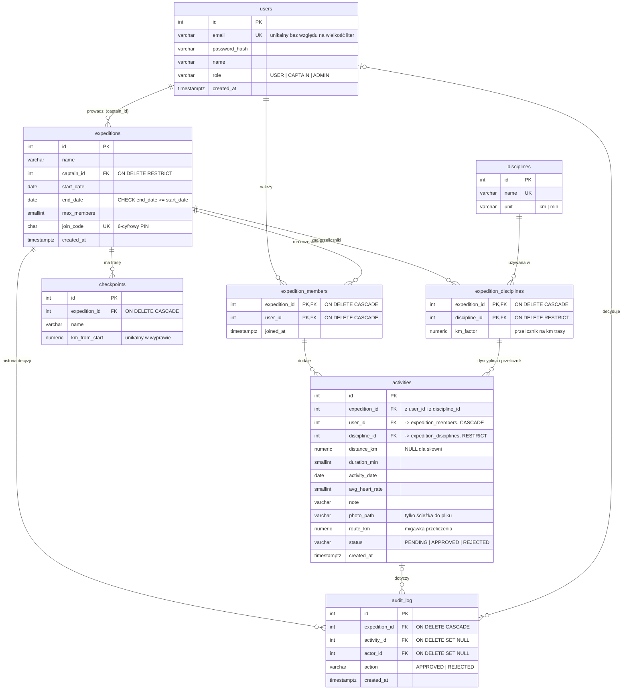

# Nazwa projektu

Jedno zdanie: jaki problem rozwiązujemy, dla kogo i w jaki sposób.

## Funkcje

| Obszar | Co robi |
|---|---|
| Strona startowa | Krótki opis funkcji |

## Tech stack

| Warstwa | Technologie |
|---|---|
| Backend | PHP 8.3 |
| Baza danych | PostgreSQL 17 |
| Serwer HTTP | Nginx |
| Konteneryzacja | Docker Compose |

## Szybki start

```bash
git clone https://github.com/LOGIN/REPOZYTORIUM.git
cd REPOZYTORIUM
docker compose up --build -d
```

Aplikacja: http://localhost:8080

## Struktura projektu

Krótki opis najważniejszych katalogów.

## Baza danych

Schemat: [`docker/db/01-schema.sql`](docker/db/01-schema.sql), dane demo: [`docker/db/02-seed.sql`](docker/db/02-seed.sql).
Oba pliki ładują się automatycznie przy pierwszym starcie kontenera `db`; żeby wgrać je od nowa:
`docker compose down -v && docker compose up -d` (usuwa dane w bazie).



**Najważniejsze decyzje:**
- `activities` ma złożone klucze obce do `expedition_members` i `expedition_disciplines` – baza sama pilnuje,
  że aktywność dodaje członek wyprawy i tylko w dyscyplinie włączonej w tej wyprawie.
- `route_km` to migawka przeliczenia z dnia dodania – zmiana przelicznika nie przepisuje historii.
- Status wyprawy i długość trasy nie są kolumnami – wynikają z dat i ostatniego checkpointu.
- `audit_log` używa `SET NULL`, żeby historia decyzji kapitana przetrwała usunięcie aktywności lub konta.

## Zasady developmentu

- Branch dla każdej funkcji.
- Małe, logiczne commity.
- Sekrety wyłącznie w .env.

## Autorzy

- Imię i nazwisko — zakres odpowiedzialności