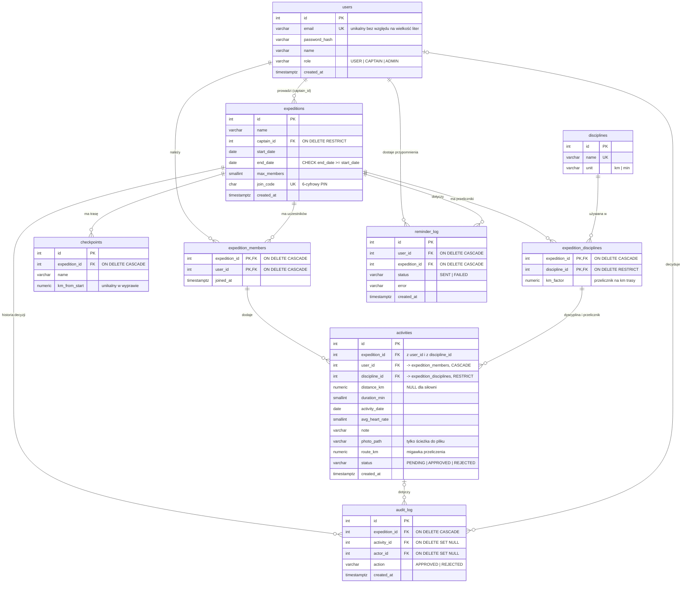

# Nazwa projektu

Jedno zdanie: jaki problem rozwiązujemy, dla kogo i w jaki sposób.

## Funkcje

| Obszar | Co robi |
|---|---|
| Strona startowa | Krótki opis funkcji |

## Tech stack

| Warstwa | Technologie |
|---|---|
| Backend | PHP 8.3 |
| Baza danych | PostgreSQL 17 |
| Serwer HTTP | Nginx |
| Konteneryzacja | Docker Compose |

## Szybki start

```bash
git clone https://github.com/LOGIN/REPOZYTORIUM.git
cd REPOZYTORIUM
docker compose up --build -d
```

Aplikacja: http://localhost:8080

## Struktura projektu

Krótki opis najważniejszych katalogów.

## Baza danych

Schemat: [`docker/db/01-schema.sql`](docker/db/01-schema.sql), dane demo: [`docker/db/02-seed.sql`](docker/db/02-seed.sql).
Oba pliki ładują się automatycznie przy pierwszym starcie kontenera `db`; żeby wgrać je od nowa:
`docker compose down -v && docker compose up -d` (usuwa dane w bazie).



**Najważniejsze decyzje:**
- `activities` ma złożone klucze obce do `expedition_members` i `expedition_disciplines` – baza sama pilnuje,
  że aktywność dodaje członek wyprawy i tylko w dyscyplinie włączonej w tej wyprawie.
- `route_km` to migawka przeliczenia z dnia dodania – zmiana przelicznika nie przepisuje historii.
- Status wyprawy i długość trasy nie są kolumnami – wynikają z dat i ostatniego checkpointu.
- `audit_log` używa `SET NULL`, żeby historia decyzji kapitana przetrwała usunięcie aktywności lub konta.

## Zadania cykliczne (CRON) i maile

**Przypomnienie dla nieaktywnych** – [`bin/send-reminders.php`](bin/send-reminders.php):
mail do uczestników trwających wypraw, którzy od 48 h nie dodali treningu (odrzucony się nie liczy),
z postępem drużyny i linkiem do formularza. Nie dostaje go ktoś, kto dołączył do wyprawy w ostatnich 48 h
ani kto w tym czasie dostał już przypomnienie o tej wyprawie.

| | |
|---|---|
| Harmonogram | codziennie o 18:00 (czas kontenera, UTC) – [`docker/cron/crontab`](docker/cron/crontab), serwis `cron` w `docker-compose.yaml` (busybox `crond`) |
| Polecenie | `php /app/bin/send-reminders.php` (tylko z CLI, plik leży poza `public/`) |
| Wynik | podsumowanie dopisywane do `/var/log/reminders.log` w kontenerze `cron`; każda wysyłka w tabeli `reminder_log` (`SENT` / `FAILED` + treść błędu) |
| Kod wyjścia | `0` – OK, `1` – błąd (np. baza niedostępna), `2` – część maili się nie wysłała |
| Poczta | `App\Mailer` (PHPMailer, SMTP z `.env`: `SMTP_HOST`, `SMTP_PORT`, `SMTP_USER`, `SMTP_PASSWORD`, `MAIL_FROM`); lokalnie Mailpit |

**Bezpieczne ponowienie:**
- ponowne uruchomienie pomija osoby z wpisem `SENT` z ostatnich 48 h – nikt nie dostanie maila dwa razy;
- wpisy `FAILED` (np. serwer SMTP niedostępny) są ponawiane przy kolejnym uruchomieniu;
- dwa uruchomienia naraz blokuje `pg_try_advisory_lock` – drugie kończy się komunikatem „another run is in progress”;
- błąd wysyłki do jednej osoby jest zapisywany, a skrypt idzie dalej do kolejnych.

**Jak przetestować:**

```bash
# tabela reminder_log na istniejącej bazie (nowa baza ładuje ją sama)
docker compose exec db sh -c 'psql -U "$POSTGRES_USER" -d "$POSTGRES_DB" -f /docker-entrypoint-initdb.d/05-reminders.sql'

docker compose exec php php bin/send-reminders.php --dry-run   # kto dostałby przypomnienie, bez wysyłki
docker compose exec php php bin/send-reminders.php             # wysyłka – maile w Mailpit: http://localhost:8025
docker compose exec php php bin/send-reminders.php             # drugi raz: „sent 0” (bez duplikatów)

docker compose exec -e SMTP_PORT=1 php php bin/send-reminders.php   # symulacja awarii SMTP → wpisy FAILED, kod 2
docker compose exec cron sh -c 'cat /etc/crontabs/root; tail /var/log/reminders.log'   # harmonogram i log crona
```

## Zasady developmentu

- Branch dla każdej funkcji.
- Małe, logiczne commity.
- Sekrety wyłącznie w .env.

## Autorzy

- Imię i nazwisko — zakres odpowiedzialności